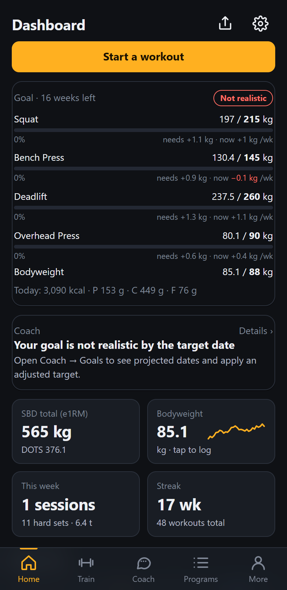
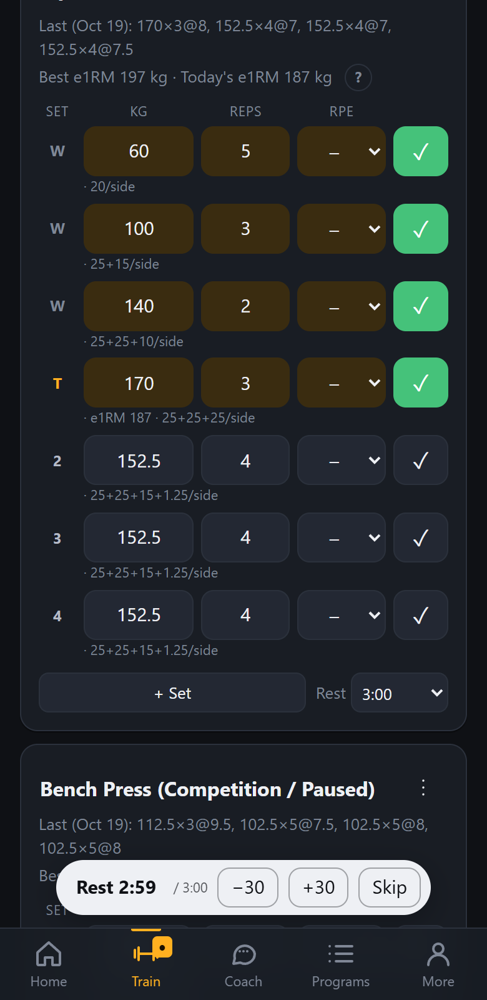
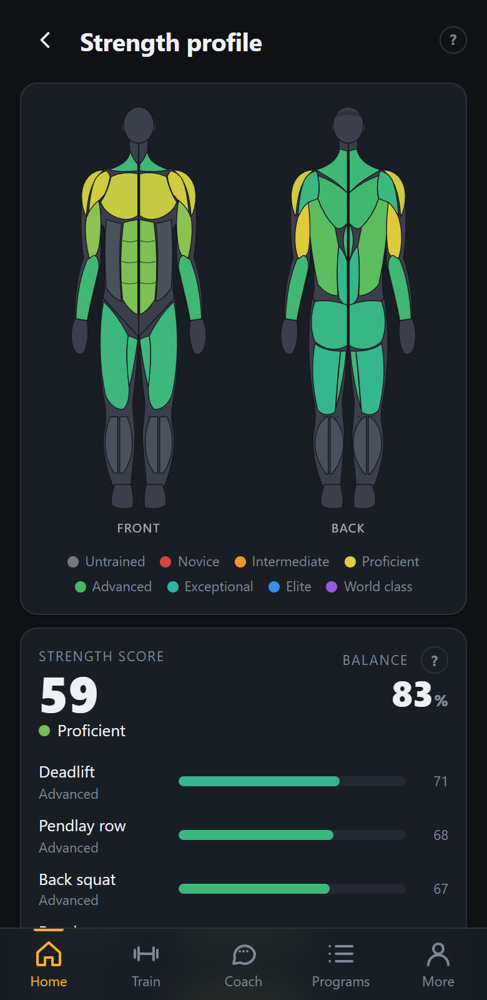
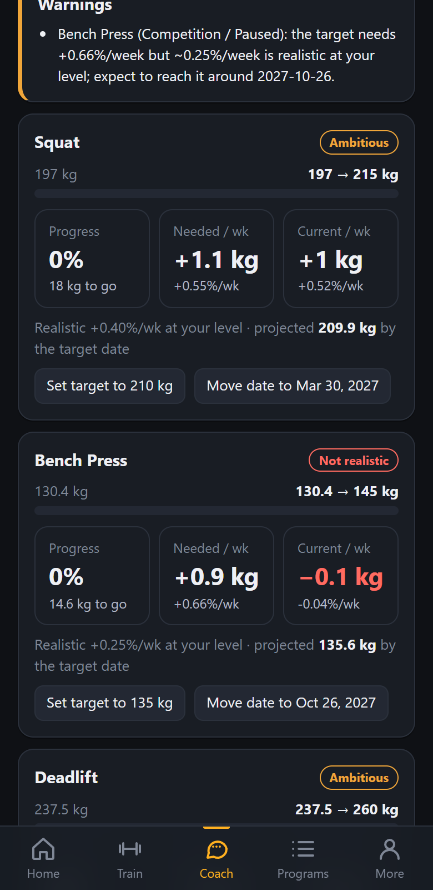
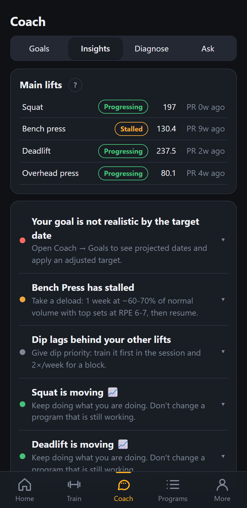
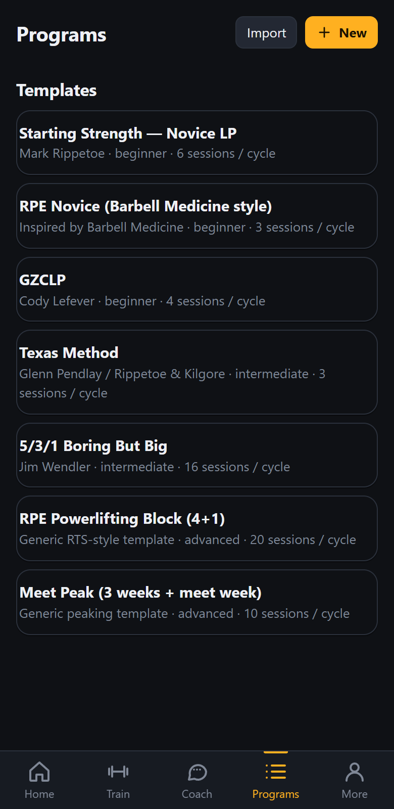

<div align="center">

# Strength Tracker

**A training log that actually coaches you.**

RPE autoregulation, estimated 1RMs, strength standards on an anatomical muscle map, goal projections, and an AI coach that reads your last six weeks before it opens its mouth.

[](https://diogocosta408.github.io/strength-tracker/)

Installable PWA · works offline · your data stays on your device

  

</div>

---

## Why this exists

Most logs are a spreadsheet with a timer. This one does the thinking that usually happens on paper between sets: what weight to take today given how last week felt, whether you're actually getting stronger or just busier, which lift is holding your total back, and whether the goal you wrote down in January is still real.

---

## The interesting parts

### Autoregulation that reacts mid-session

Prescribe a set as `5 @ RPE 8` and the weight comes from your recent e1RM via the RTS RPE chart. Log the set and **the remaining sets re-calculate from today's e1RM** — if 5 @ RPE 7 felt like an 8, the next jumps shrink automatically. Overshoot a top set and the back-offs are computed from the weight that *would* have hit the target, not the one you ground out.

Weights you typed yourself are never touched.

Prescriptions can be `reps @ RPE`, `% of e1RM`, fixed kg, `% of today's top set` (load drops), or linear progression (`+2.5 kg` after a success, repeat after a miss).

### A strength profile you can read at a glance


Every lift is scored against **[Symmetric Strength](https://symmetricstrength.com/standards)'s published standards**, adjusted for sex and age, across eight levels from Untrained to World class. Those scores spread over an anatomical front/back muscle map, so weak links show up as a colour rather than a spreadsheet column.

- **Strength score** plus a **balance %** — how even your lifts are relative to each other
- Per-lift bars with level and points, and the kg needed for the next level
- **Imbalance detection**: lifts more than 10 points behind your average, with the weight that would close the gap
- Tap any muscle to see which lifts feed its score
- A score trend chart: your overall score recalculated week by week from the e1RMs logged up to each point

<br clear="right">

### Goals that tell you the truth



Set target lifts (by kg or by strength level), a target bodyweight and a date. Each goal is **projected week by week** — progress naturally slows as you get stronger, slows further in a calorie deficit, and tapers with age, all blended with your own 12-week trend.

Each lift shows **progress %, the gain per week the target needs, and the rate you're actually hitting**, in kg. Goals are rated on track / ambitious / not realistic, and when one isn't realistic the app offers an achievable target *or* a moved date — one tap to apply either.

It also flags conflicts, like chasing PRs while cutting hard, and turns the goal into a daily calorie and macro target.

<br clear="left">

### An AI coach that reads the data first



Three layers, two of them fully offline:

- **Insights** (offline): detects progressing, stalled and regressing lifts, then looks for *why* — RPE drift at the same loads, frequency that's dropped, volume too low or too high, no variation work, a linear progression that's run out, bodyweight falling. Each finding comes with concrete actions.
- **Diagnose** (offline): a short interview per lift — where it fails (off the chest, out of the hole, at the knee), what breaks down, how the reps feel, plus sleep and diet phase. Answers with targeted variations and accessories, sets × reps @ RPE, addable to your program in one tap.
- **Ask coach** (AI): a chat with a Gemini-powered strength coach that gets your last six weeks, lift trends, goal feasibility and diagnostic answers as context. It asks follow-up questions before prescribing. Runs on **your own free Google AI Studio key** — see below.

<br clear="right">

### Programs, including the one you already paid for



Built-in templates: Starting Strength, RPE Novice, GZCLP, Texas Method, 5/3/1 BBB, a 4+1 RPE powerlifting block and a meet peak. Copy any of them and edit weeks → days → exercises → sets.

**Tap an exercise to swap it** — the picker opens on that exercise's own category with the closest alternatives ranked first (swapping a sumo deadlift offers the other deadlift variations), and keeps the sets, reps, RPE and rest already set up.

Programs import and export as `.program.json` files, and `scripts/bbm_template_to_program.py` converts a Barbell Medicine weekly template spreadsheet — RPE ramps, load drops, repeats, %e1RM work, GPP — into one.

<br clear="left">

### Logging that keeps up at the gym


- Sets × kg × reps × RPE with set types: warm-up, work, top, back-off, AMRAP
- Tick a set to accept the prescription — the rest timer starts with vibration and a beep
- **Plate loading per side** under every set, and a one-tap warm-up ramp
- Last session's numbers, best e1RM and today's e1RM always in view
- Reorder exercises, replace one mid-session, add notes, repeat a past session
- Log a session after the fact and set its real date and time

<br clear="right">

### And the rest

- **Dashboard**: SBD total and DOTS, all four main lifts overlaid on one e1RM chart (tap one to focus), weekly tonnage / hard sets, streak, recent PRs, and when your next planned session is due
- **Calculators**: 1RM (7 formulas plus the RPE chart), RPE load, back-off from today's top set, IPF GL / DOTS / Wilks / Wilks 2020, plates, meet attempt selector
- **Exercise library**: 225+ exercises with competition variations (pause, pin, tempo, SSB, deficit, block, Larsen, Spoto, board…), muscles and equipment — add your own
- **Bodyweight & nutrition**: 7-day moving average, optional daily calories/protein, maintenance worked out from your real intake and weight trend once ~10 days are logged
- **Share card**: a PNG of your best lifts with total, DOTS/Wilks and muscle map
- **Data**: cloud sync, JSON backup/restore, CSV export of every set, demo data to try it out

---

## Getting started

Open **[the live app](https://diogocosta408.github.io/strength-tracker/)** on your phone and choose **Add to Home Screen** (Safari share menu on iOS, Chrome menu on Android). It then runs full-screen and works offline — the service worker caches everything, so it keeps working in a basement gym with no signal.

Everything is stored locally in IndexedDB. Nothing leaves your device unless you turn on cloud sync or use the AI coach.

> **Tip:** hit **Load demo data** in Settings → Your data to explore with ~16 weeks of realistic training before logging anything of your own.

---

## Get a free Google AI Studio key (for the AI coach)

The chat coach needs an API key. Google's free tier is plenty for everyday use.

1. Go to **[aistudio.google.com/apikey](https://aistudio.google.com/apikey)** and sign in with a Google account.
2. Click **Create API key** (create a project if it asks — any name works).
3. Copy the key — it starts with `AIza…`.
4. In the app: **Coach → Ask → Connect the AI coach**, paste it in, then **Save key**.

The key is stored in that browser only. It's never included in backups or cloud sync, and requests go straight from your device to Google.

The model isn't hard-coded: on first use the app asks your key which models it can reach and picks the best available chat model, so it keeps working when Google renames or retires one.

> **Cost:** the free tier has per-minute and per-day limits and is normally enough. If you hit one, the coach says so and you can retry shortly.

---

## Cloud sync (optional)

Sync keeps the same log on your phone and your computer, backed up in **your own Google Drive**. It writes to Drive's hidden `appDataFolder`, so the file never appears in drive.google.com or any file picker — only this app can read it. Your AI coach key is never included.

It merges rather than overwrites: new workouts from two devices are unioned by record, deletions stick via tombstones, and edits to the same record resolve by most recent. The last 7 daily snapshots are kept so a bad sync can be rolled back.

Turn it on in **Settings → Cloud sync → Connect Google Drive**.

> ### ⚠️ Currently in test mode
>
> The Google OAuth consent screen for this app is still in **Testing**, so Google only lets **approved testers** connect their Drive. If you try it and see *"has not completed the Google verification process"*, that's why — nothing is broken.
>
> **Want access? Message me with the Google account email you'd use** and I'll add you as a tester. Everything else in the app works without it.

Running your own copy? See [Cloud sync setup](#cloud-sync-setup) below.

---

## Run it yourself

```bash
npm install
npm run dev        # http://localhost:5173
npm test           # unit tests
npm run build      # static build in dist/
```

The build uses relative paths, so `dist/` can be served from any static HTTPS host, including a sub-path.

### Deploying to GitHub Pages

`.github/workflows/deploy.yml` builds and publishes on every push to `main`. One-time setup:

1. **Settings → Pages → Build and deployment → Source**: **GitHub Actions**.
2. Add the `VITE_GOOGLE_CLIENT_ID` secret (below) if you want cloud sync, then push.

### Cloud sync setup

Cloud sync needs an OAuth client of your own. It's a plain redirect flow — no backend, no client secret, no third-party SDK.

**1. Google Cloud Console**

1. Create a project at [console.cloud.google.com](https://console.cloud.google.com).
2. **APIs & Services → Enabled APIs** → enable the **Google Drive API**.
3. **OAuth consent screen** → **External**, add the `drive.appdata` scope, and add the Google accounts that should be able to connect as **test users**. No verification needed — the scope is non-sensitive and limited to the app's own hidden folder.
4. **Credentials → Create credentials → OAuth client ID** → **Web application**. Under **Authorized redirect URIs** add:
   - `https://<your-user>.github.io/<your-repo>/oauth-callback.html`
   - `http://localhost:5173/oauth-callback.html`
5. Copy the **Client ID**.

**2. Configure the app**

- **Local**: copy `.env.example` to `.env.local`, set `VITE_GOOGLE_CLIENT_ID`, restart the dev server. Without it, Settings → Cloud sync falls back to an in-browser mock so the UI stays clickable.
- **GitHub Pages**: add a repo secret named `VITE_GOOGLE_CLIENT_ID` under **Settings → Secrets and variables → Actions**, then re-run the deploy workflow.

**Limitation:** with no backend there's no refresh token, so the ~1 hour access token can't renew silently. When it expires, Settings shows **Reconnect** and one tap fixes it.

---

## Code map

| Path | What |
|------|------|
| `src/lib/calc.ts` | RPE chart, e1RM formulas, Wilks / Wilks2 / DOTS / IPF GL, plates, warm-ups |
| `src/lib/strength.ts` | Symmetric Strength standards, scoring, lift → muscle weights, colour ramp |
| `src/lib/stats.ts` | History, bests, rep maxes, PR detection, load suggestions, weekly stats |
| `src/lib/workout.ts` | Starting / finishing sessions, warm-ups, back-offs, next session due |
| `src/lib/store.ts` | App state, IndexedDB persistence, lookups |
| `src/lib/coach.ts` | Training analysis: trends, stalls, fatigue, volume/intensity, AI context summary |
| `src/lib/goals.ts` | Goal feasibility, projections, adjusted targets, calorie and macro plan |
| `src/lib/coachAi.ts` | Gemini client for the chat coach (SSE streaming, model resolution) |
| `src/lib/merge.ts` | Pure merge logic for cloud sync (union by id, tombstones, last-write-wins) |
| `src/lib/sync.ts` | Sync scheduling: debounce, connect/sync/disconnect, snapshots |
| `src/lib/googleAuth.ts` | OAuth redirect flow for the Drive appDataFolder scope |
| `src/lib/googleDrive.ts` | Drive v3 REST calls, scoped to the hidden appDataFolder |
| `src/lib/exerciseMatch.ts` | Ranking alternatives when swapping an exercise |
| `src/data/exercises.ts` | Exercise library |
| `src/data/programs.ts` | Built-in program templates |
| `src/data/coachKnowledge.ts` | Diagnostic questions, weak-point → variation/cue knowledge base |
| `src/components/BodyMap.tsx` | Anatomical SVG muscle map |
| `src/components/Charts.tsx` | Line, multi-line, bar and sparkline charts |
| `src/screens/*` | Dashboard, Train, Logger, Programs, Tools, Strength, Body, Share, History, Coach, Settings |

---

## Notes

- With an RPE logged, e1RM uses the RTS RPE chart; without one it falls back to Epley or Brzycki (configurable).
- For bodyweight exercises (pull-ups, dips…) you log the added weight, and bodyweight is included for e1RM and standards.
- Strength standards are derived from Symmetric Strength's published tables and converted to bodyweight ratios. Their model scales by Wilks rather than a flat ratio, so these track it closely rather than matching exactly. Treat levels as a guide, not a ranking.
- The RPE Novice template is inspired by Barbell Medicine's approach. Their official programs are sold at [barbellmedicine.com](https://www.barbellmedicine.com).
